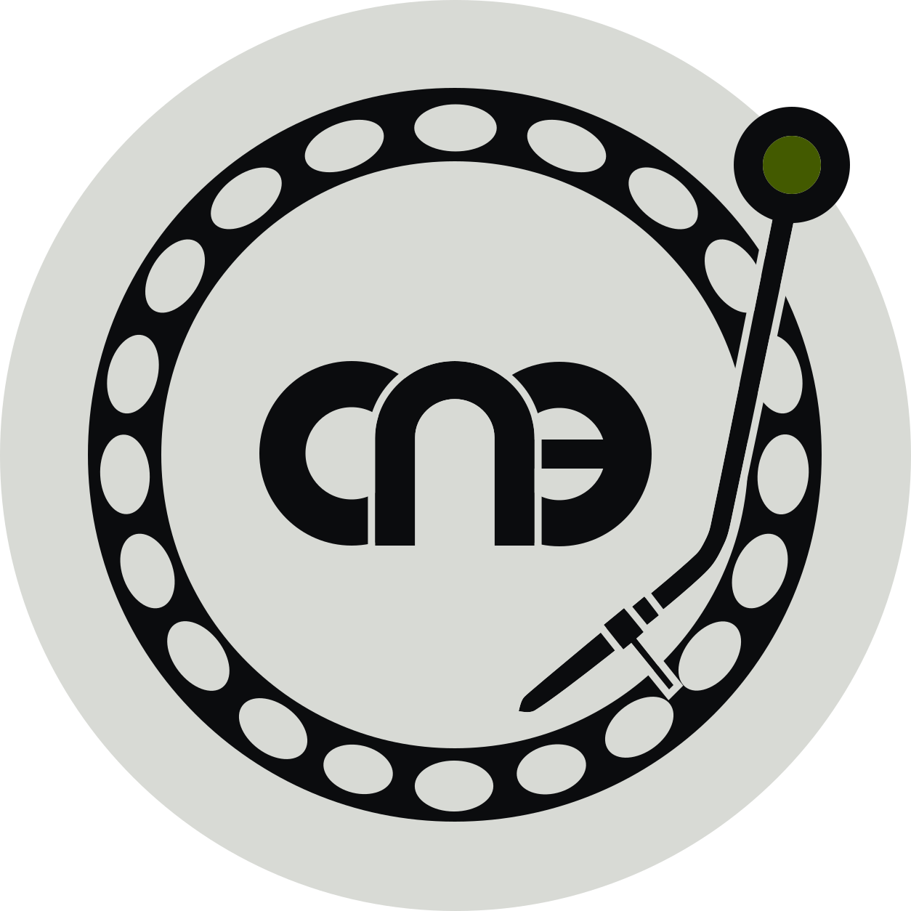

# StemDock 0.9 (BETA)

**Deutsch** · [English below](#english)

Kostenloses Hilfsprogramm für den **Pioneer CDJ-2000NXS**.

- Erstellt aus **deiner eigenen** Original-Firmware 1.44 eine **Update-Datei** mit der Stem-Mod.
- Bereitet deinen **USB-Stick** vor: **4 Layer** pro Titel (Vocal, Melody, Bass, Drums).
- Läuft **lokal**, nichts wird hochgeladen.

> **BETA, auf eigenes Risiko:** Flashen kann den Player **beschädigen**. Nicht alles ist auf echter Hardware erprobt. **Originaldatei 1.44 aufheben.**

## Das brauchst du

- **Mac** mit Apple-Chip (Windows ungetestet)
- Deine **Originaldatei 1.44** (`C2KNXS.UPD` oder `C2KNXSM.UPD`) von Pioneer
- **FAT32**-USB-Stick
- **rekordbox**-Export (Ordner `PIONEER/rekordbox`)
- Nur zum Trennen: **Python 3.10 bis 3.12** und Internet (einmalig)

## Installieren (macOS)

- `StemDock.app` in den Ordner **Programme** legen.
- Die App ist **nicht notarisiert**: erster Start per **Rechtsklick > Öffnen > Öffnen**.
- Alternativ: **Systemeinstellungen > Datenschutz & Sicherheit > Dennoch öffnen**.
- Beim ersten Start den **Hinweis** bestätigen.

Das **?** auf jeder Karte zeigt eine Kurzhilfe.

## 1. Firmware: Update-Datei erstellen

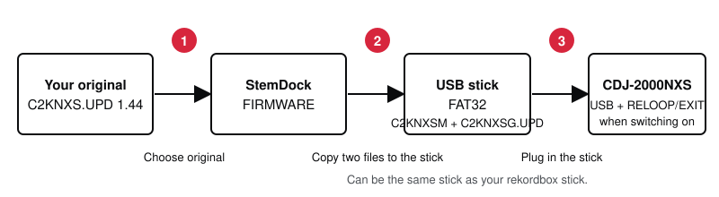

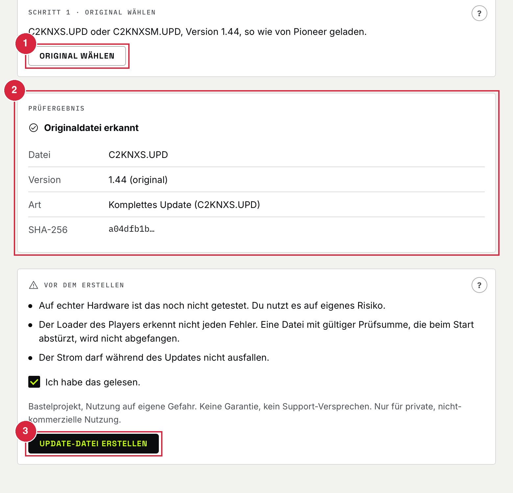

1. **Original wählen**: deine Datei 1.44.
2. **Prüfergebnis**: StemDock lehnt falsche oder schon veränderte Dateien ab.
3. Haken setzen, **Update-Datei erstellen** (ca. 15 s).

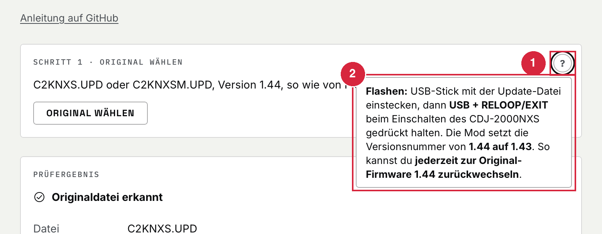

1. **?** öffnet die Kurzhilfe (auch per Tastatur).
2. Dort stehen **Flashen** und **Rückweg**.

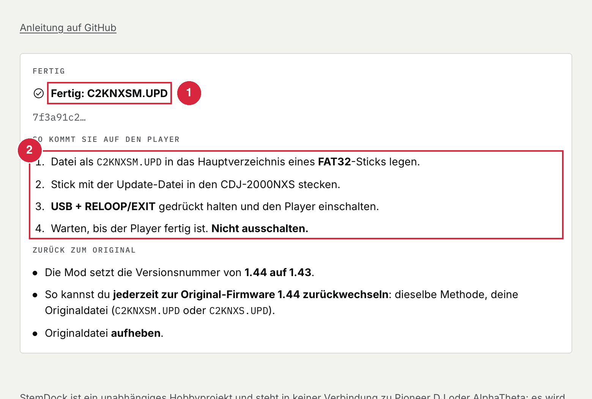

1. Datei heißt **`C2KNXSM.UPD`**.
2. Die Schritte zum Flashen stehen in der App.

**Flashen:**

- **Reihenfolge:** **USB + RELOOP/EXIT** beim Einschalten des CDJ-2000NXS gedrückt halten
- Meldung **"Connect the USB storage device"** abwarten, **dann** den Stick einstecken
- Warten, **nicht ausschalten**, Strom darf nicht ausfallen
- **Stick:** leer oder der **rekordbox-Stick**, immer **FAT32**; Datei ins Hauptverzeichnis
- **Zurück zur Original-Firmware inkl. GUI:** **USB STOP + USB + RELOOP/EXIT** beim Einschalten gedrückt halten.

**Rückweg:**

- Die Mod setzt die Versionsnummer von **1.44 auf 1.43**.
- So kannst du **jederzeit zur Original-Firmware 1.44 zurückwechseln**: gleiche Methode, deine Originaldatei.

## 2. Titel in 4 Layer trennen (PREP)

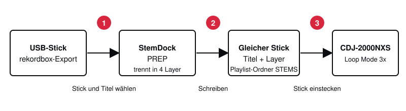

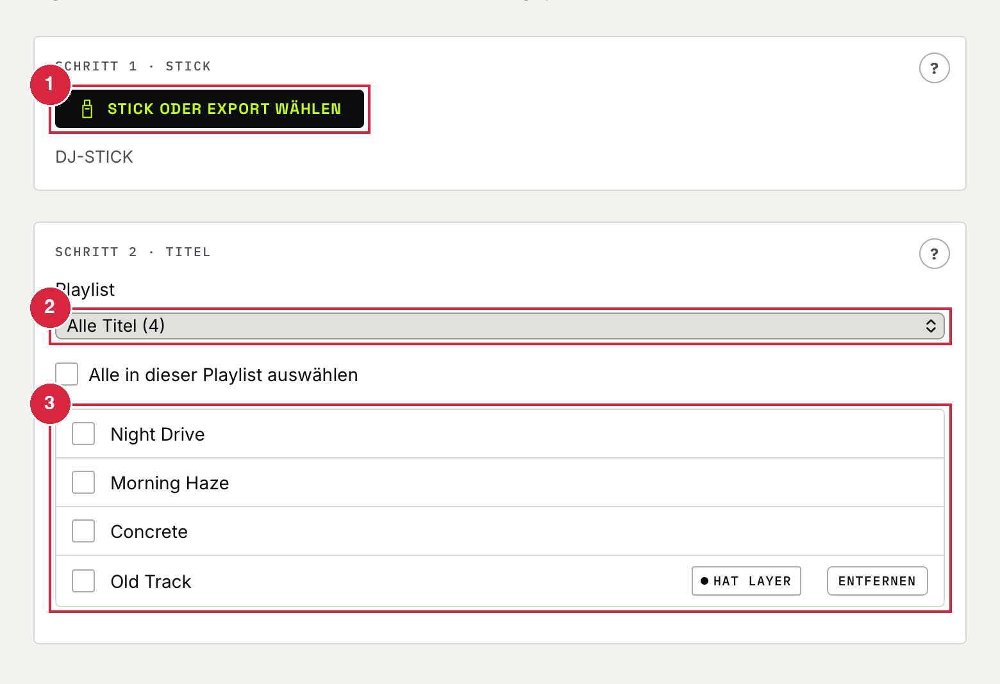

1. **Stick oder Export wählen**.
2. **Playlist** wählen.
3. **Titel** ankreuzen (bereits getrennte sind markiert).

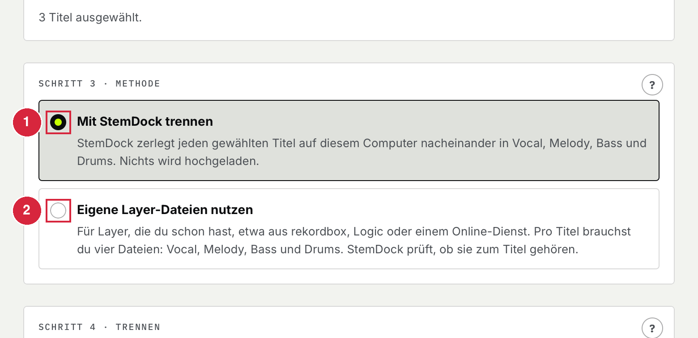

1. **Mit StemDock trennen**: braucht das Zusatzpaket (siehe Einstellungen).
2. **Eigene Layer-Dateien**: 4 Dateien pro Titel, StemDock ordnet zu und prüft.

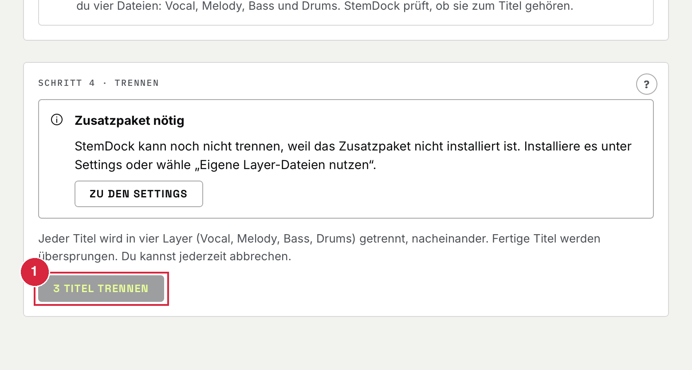

1. **Titel trennen**: nacheinander, **Abbrechen** jederzeit.

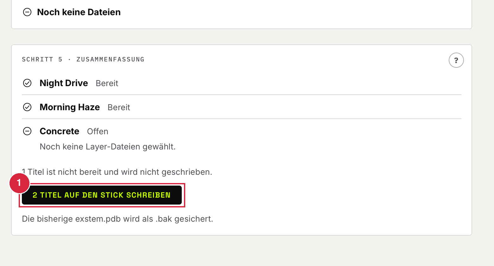

1. **Auf den Stick schreiben**: Musik und Export bleiben **unverändert**, `exstem.pdb` wird als `.bak` gesichert.

- Titel mit Layer liegen im Playlist-Ordner **STEMS**.
- **Entfernen** löscht nur die Layer eines Titels.
- **Platz:** etwa **53 MB pro Minute** Musik auf dem Stick (gemessen: 270 MB für 5:06).

## 3. Einstellungen

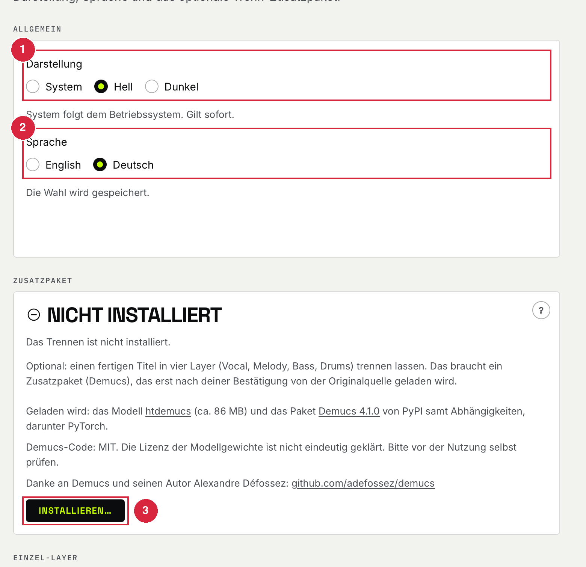

1. **Darstellung:** System, Hell oder Dunkel.
2. **Sprache:** Deutsch oder English.
3. **Zusatzpaket:** installiert Demucs zum Trennen (**ca. 0,8 GB** + Modell **ca. 86 MB**), nur nach Bestätigung, **Entfernen** löscht es wieder. Code: MIT, Lizenz der Modellgewichte **nicht eindeutig**, bitte selbst prüfen.

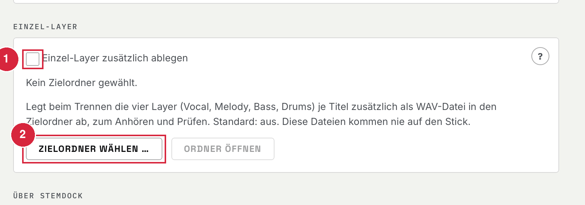

1. **Einzel-Layer zusätzlich ablegen:** speichert die 4 Layer als WAV zum Anhören (Standard **aus**, nie auf den Stick).
2. **Zielordner wählen:** wohin die WAV-Dateien kommen.

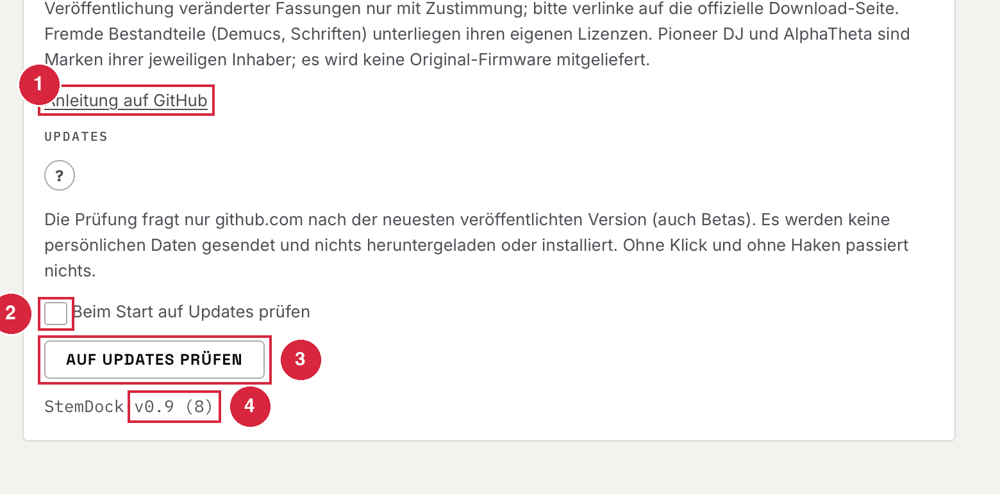

1. **Anleitung auf GitHub:** öffnet diese Seite.
2. **Beim Start auf Updates prüfen:** Standard **aus**.
3. **Auf Updates prüfen:** fragt nur **github.com** nach der neuesten Version (auch Betas), lädt nichts.
4. **Version** der App.

## Am Player

- **Loop Mode 3x:** Layer über **Rampen** steuern.
- **Loop Mode 2x (Pads):** **in Arbeit**.

## Bekannte Grenzen

- **BETA**, nicht alles auf Hardware erprobt
- Immer genau **4 Layer** pro Titel
- Trennen braucht Zusatzpaket, Python 3.10 bis 3.12 und Zeit
- Windows ungetestet, App nur ad-hoc signiert

## Danke

- **Demucs** und Alexandre Défossez: https://github.com/adefossez/demucs
- Emulatoren: [CDJ-2000 Emulator](https://github.com/cdj2k-revival/cdj2000-emulator) (cdj2k-revival), [cdj-nxs2-qemu](https://github.com/Stijn-Jacobs/cdj-nxs2-qemu) (Stijn-Jacobs)

## Spende und Kontakt

- StemDock ist kostenlos, die Entwicklung war es nicht (viele bezahlte AI-Tokens): [Spende auf Ko-fi](https://ko-fi.com/cne_dj)
- Kontakt: http://cne-dj.com · http://cne-lab.de

## Haftung

- Bastelprojekt, **eigene Gefahr**, keine Garantie, kein Support-Versprechen
- Nur private, nicht-kommerzielle Nutzung
- Unabhängig, **keine Verbindung** zu Pioneer DJ oder AlphaTheta

---

## English

Free helper tool for the **Pioneer CDJ-2000NXS**. **Local only**, nothing is uploaded.

- **BETA, at your own risk:** flashing can **damage** the player. **Keep your original 1.44 file.**
- **Needs:** Mac with Apple chip, your **own 1.44 file**, **FAT32** stick, rekordbox export; for separating **Python 3.10 to 3.12**.
- **Install:** not notarized, first start via **right-click > Open > Open**.
- **Firmware:** FIRMWARE tab > **Original wählen** > **create update file** (`C2KNXSM.UPD`) > copy to the stick (empty or the **rekordbox stick**, always **FAT32**).
- **Flash:** hold **USB + RELOOP/EXIT** while switching on the CDJ-2000NXS, wait for **"Connect the USB storage device"**, then plug in the stick.
- **Back to the original firmware including GUI:** hold **USB STOP + USB + RELOOP/EXIT** while switching on.
- **Way back:** the mod changes the version from **1.44 to 1.43**, so you can **switch back to the original firmware 1.44 at any time**.
- **Stems:** PREP tab > choose stick, playlist, tracks > method (**separate** with the add-on or **own layer files**) > write. About **53 MB per minute** on the stick.
- **Settings:** appearance, language, add-on package (Demucs, about 0.8 GB + 86 MB model), single-layer WAV export (off by default), optional update check (github.com only, off by default).
- **Player:** **Loop Mode 3x** ramps; **Loop Mode 2x** pads: work in progress.
- **Thanks:** Demucs / Alexandre Défossez; [CDJ-2000 Emulator](https://github.com/cdj2k-revival/cdj2000-emulator), [cdj-nxs2-qemu](https://github.com/Stijn-Jacobs/cdj-nxs2-qemu). **Donate:** https://ko-fi.com/cne_dj. **Contact:** http://cne-dj.com · http://cne-lab.de
- **Disclaimer:** hobby project, no warranty, private non-commercial use, not affiliated with Pioneer DJ or AlphaTheta.

---

[LICENSE.txt](LICENSE.txt) · [THIRD-PARTY.md](THIRD-PARTY.md) · [CHANGELOG.md](CHANGELOG.md)
